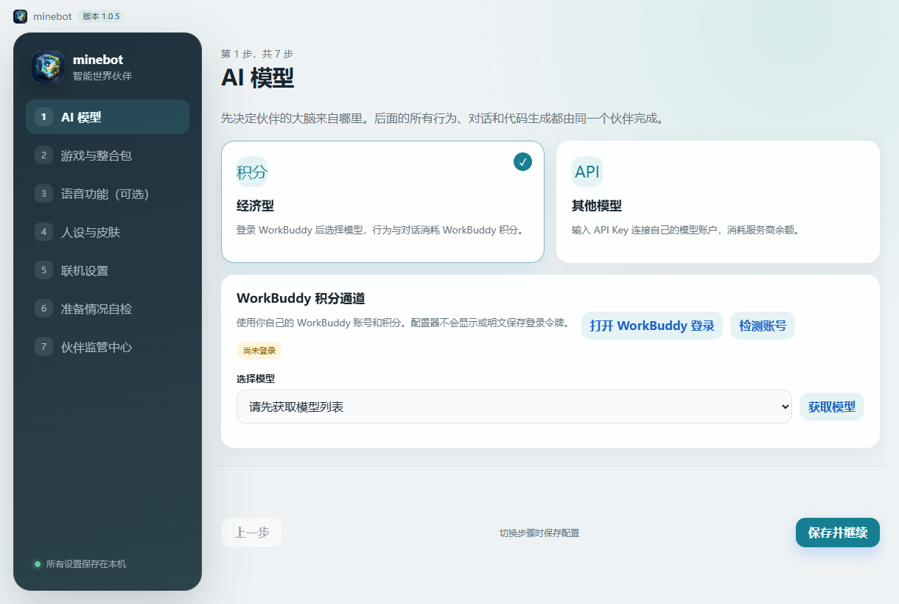

<p align="center">
  
</p>

<p align="center">
  <a href="https://github.com/sasika-bottt/AIbot-minecraft/releases/latest"></a>
  
  <a href="LICENSE"></a>
  <a href="https://github.com/sasika-bottt/AIbot-minecraft/actions/workflows/release-minebot.yml"></a>
</p>

<p align="center"><b>使用你自己的整合包和存档，配置服务器，与一个 AI 伙伴共同游玩。</b></p>
<p align="center">
  <a href="https://github.com/sasika-bottt/AIbot-minecraft/releases/latest"><b>下载 Windows 安装包</b></a> ·
  <a href="docs/GETTING_STARTED.md">使用指南</a> ·
  <a href="docs/COMPATIBILITY.md">支持范围</a> ·
  <a href="CHANGELOG.md">更新记录</a> ·
  <a href="https://github.com/sasika-bottt/AIbot-minecraft/issues">反馈问题</a>
</p>

## 从你的世界开始

minebot 是一款简体中文 Windows 桌面应用，把模型配置、整合包识别、服务器准备与伙伴监管放进同一个向导。**安装包已包含 Node 和伙伴运行组件，用户无需另行配置 Node 或 Python。**

| 你想做的事 | minebot 提供的功能 |
| --- | --- |
| 选择 AI 模型 | WorkBuddy 积分通道，或自己的 OpenAI 兼容 API |
| 使用已有游戏内容 | 识别 PCL2 实例，导入本地 ZIP / MRPACK / 7Z 或已解压目录，选择自己的世界 |
| 准备服务器 | 匹配 Java，按版本准备原版 / Fabric / Forge / NeoForge 服务端；下载校验与有限次数重试 |
| 设置伙伴 | 一个 Agent 承担对话和行为，自定义人设、皮肤和行为模式；语音可选 |
| 管理运行状态 | 自检、开服、日志、连接地址、多人管理员名单和管家对话窗口 |
| 保护世界进度 | 独立服务器副本，异常停服后的备份校验；安全停服后更新 `服务器存档-日期` 并作为下次来源 |

<p align="center"></p>

## 四步开始使用

1. **下载安装。** 在 [最新正式版](https://github.com/sasika-bottt/AIbot-minecraft/releases/latest) 的 Assets 中下载 `minebot-setup-1.0.7.exe`。普通用户无需下载源码。
2. **配置模型。** 使用积分通道时，在本机安装并登录自己的 WorkBuddy 账号；也可以填入自己的模型 API 地址、模型名与 API Key。
3. **选择游戏与世界。** 识别已有实例或导入自己的整合包，选择版本和存档，再设置可选语音、人设及联机方式。
4. **准备并开服。** 按向导自动准备资源、自检并启动。服务器就绪后，把界面顶部地址填入 Minecraft 的“多人游戏”。

本机游玩通常使用 `127.0.0.1:25565`，以实际显示的端口为准。外网玩家需要可用的公网映射；语音另外使用 UDP。详细操作见 [使用指南](docs/GETTING_STARTED.md)。

## 当前正式版的范围

**1.0.7 正式版**在 WorkBuddy 自动恢复基础上完善安全停服后的每日存档更新与下次开服来源切换，并保留环境准备、配置恢复、版本切换和停服保护能力。正式版不代表任意整合包或全部模组协议均已兼容。

- WorkBuddy 通道复用本机客户端登录状态；积分及 API 费用由相应服务收取。
- 可能改变世界内容的模组冲突会先展示影响，再由用户选择。不会自动删除内容模组或静默回退世界进度。
- 生存建造目前适合有限的普通方块任务；复杂配方、任意建筑和全部模组材料仍属实验范围。皮肤支持导出，跨客户端自动分发尚未实现。
- 服务器使用离线身份模式，正版与离线玩家均可连接；用户名不等于身份验证，只应邀请和授权信任的玩家。

查看 [兼容性与实验功能](docs/COMPATIBILITY.md)，了解已验证场景及限制。

## 开发与项目结构

开发环境为 Windows x64、Node.js 22。构建步骤见 [开发指南](docs/DEVELOPMENT.md)。

```text
src/          桌面应用、配置向导与服务器服务
runtime/      单 Agent 伙伴源码及兼容适配
scripts/      打包准备
tests/       自动化回归与显式运行的实机测试
docs/        当前使用、开发与兼容性说明
archive/     历史报告与旧版索引
```

公开 Git 历史和 Releases 只保留经过脱敏验证的版本；历史说明统一收纳至 [archive](archive/README.md)。仓库不收录个人账号、存档、日志、伙伴皮肤、服务器地址或游戏服务端文件。

## 许可与致谢

本项目采用 [MIT 许可证](LICENSE)。伙伴运行时基于 [Mindcraft](https://github.com/kolbytn/mindcraft)，上游版权与许可证保留在 [运行时目录](runtime/mindcraft-final/LICENSE)。感谢 Mineflayer、PrismarineJS、Fabric、Forge、NeoForge、Simple Voice Chat 及相关开源项目。游戏、模组、第三方依赖与模型服务分别遵循各自条款。
