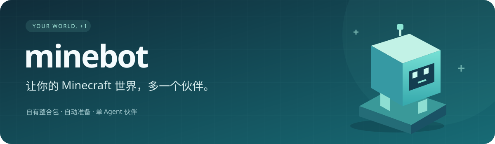
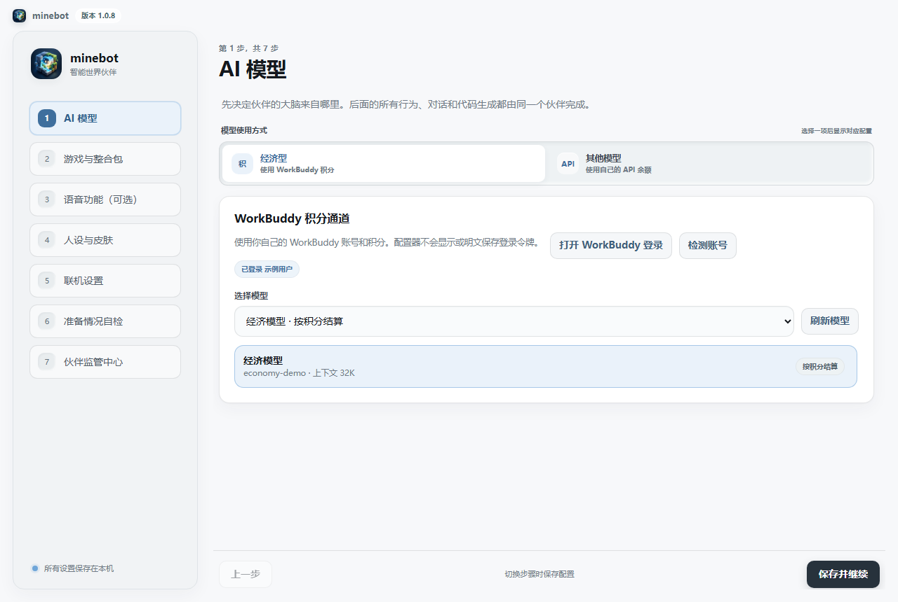
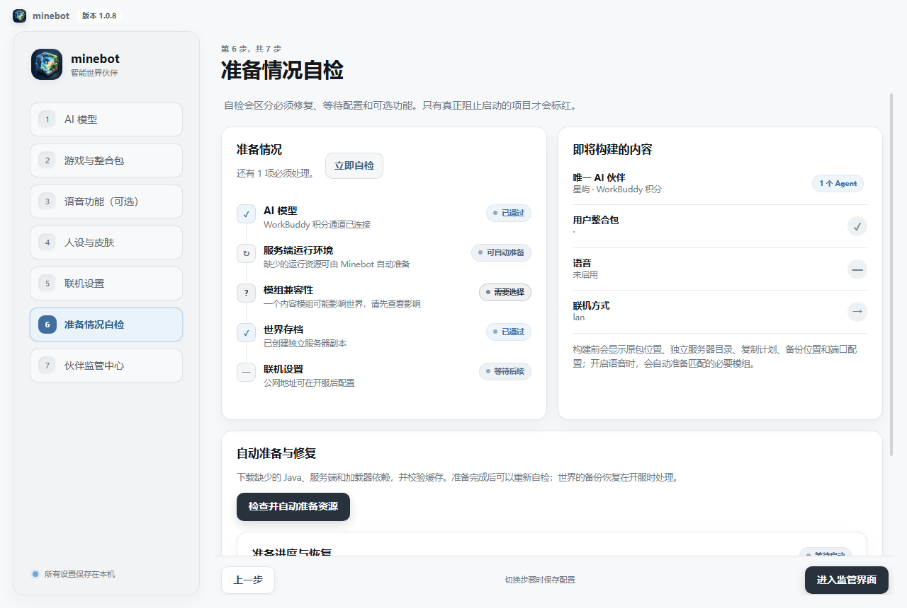
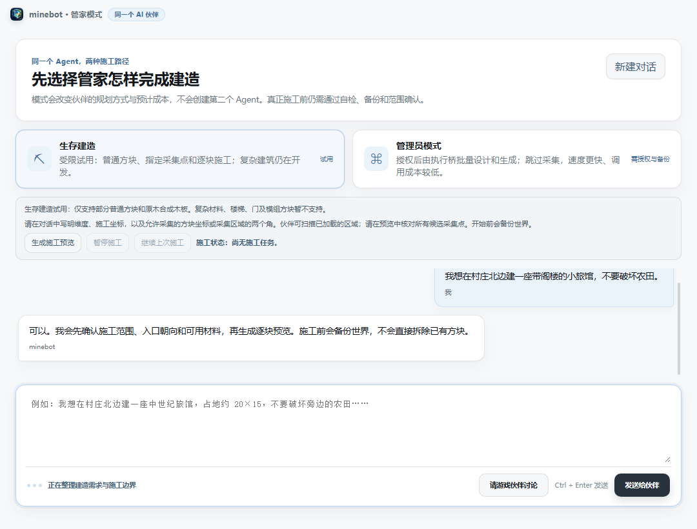

<p align="center">
  
</p>

<p align="center">
  <a href="https://github.com/sasika-bottt/AIbot-minecraft/releases/latest"></a>
  
  
  <a href="LICENSE"></a>
  <a href="https://github.com/sasika-bottt/AIbot-minecraft/actions/workflows/release-minebot.yml"></a>
</p>

<p align="center"><b>把你自己的 Minecraft 整合包和世界，交给一个清楚、可控的服务器与 AI 伙伴配置器。</b></p>
<p align="center">
  <a href="https://github.com/sasika-bottt/AIbot-minecraft/releases/latest"><b>下载 Windows 安装包</b></a> ·
  <a href="docs/GETTING_STARTED.md">使用指南</a> ·
  <a href="docs/COMPATIBILITY.md">兼容范围</a> ·
  <a href="CHANGELOG.md">更新记录</a> ·
  <a href="https://github.com/sasika-bottt/AIbot-minecraft/issues">反馈问题</a>
</p>

## minebot 能做什么

minebot 是一款简体中文 Windows 桌面应用，将模型、整合包、世界存档、服务器环境、联机地址和 AI 伙伴放进同一个配置流程。安装包已经包含 Node.js 与伙伴运行组件，普通用户不需要另外安装 Node 或 Python。

| 核心能力 | 实际作用 |
| --- | --- |
| **一个 AI 伙伴** | 只运行一个 Agent，统一承担游戏对话、行为控制、建造需求讨论和状态监管 |
| **两条模型通道** | 登录自己的 WorkBuddy 账号使用积分，或连接自己的 OpenAI 兼容 API |
| **使用自己的游戏内容** | 识别 PCL2 已安装实例，也可导入 ZIP、MRPACK、7Z 或已解压整合包并选择自己的世界 |
| **自动准备服务器环境** | 识别 Minecraft 与加载器版本，匹配 Java，并为原版、Fabric、Forge、NeoForge 准备服务端资源 |
| **自检与自动修复** | 区分已通过、可自动准备、需要选择和必须处理；能安全自动修复的项目直接处理 |
| **世界安全与恢复** | 在独立目录中构建服务器副本，异常停服保留恢复依据，安全停服后更新每日单人存档 |

## 从模型配置到自检开服

<p align="center">
  
</p>

配置器使用黑、白、灰与浅蓝构成的简洁界面。模型选择保留 WorkBuddy 积分通道和自备 API 通道；账号令牌不会明文写入项目文件，API Key 使用 Windows 系统加密保存。

<p align="center">
  
</p>

自检不是只报告错误：缺少的安全资源会进入自动准备流程；可能影响世界方块或物品的内容模组会先展示影响，再由用户决定，不会静默删除或替换。

## 管家模式：同一个伙伴，两种施工路径

<p align="center">
  
</p>

- **生存建造：** 由伙伴按照已确认的范围、材料和采集点逐步施工；当前适用于有限的普通方块任务。
- **管理员模式：** 在授权、范围确认和世界备份后执行受控方案，跳过重复采集过程。

管家模式不会创建第二个 Agent。对话、规划和游戏内伙伴仍属于同一个 AI 伙伴。

## 四步开始

1. **下载安装。** 在 [最新正式版](https://github.com/sasika-bottt/AIbot-minecraft/releases/latest) 的 Assets 中下载 `minebot-setup-1.0.8.exe`。
2. **选择模型。** 登录自己的 WorkBuddy 账号并选择积分模型，或填写自己的 API 地址、模型名和 API Key。
3. **选择整合包与世界。** 使用 PCL2 已安装实例或导入本地整合包，核对识别到的 Minecraft、加载器、Java 和存档。
4. **自检并开服。** 让 minebot 准备必要环境；服务器就绪后，把顶部显示的地址填入 Minecraft 的“多人游戏”。

本机游玩通常使用 `127.0.0.1:25565`，以应用实际显示为准。外网玩家需要可用的 TCP 公网映射；启用语音时还需要独立 UDP 通道。详细步骤见 [使用指南](docs/GETTING_STARTED.md)。

## 默认保护你的世界

- 原整合包和原世界作为来源读取，服务器在独立工作目录中构建。
- 可能改变世界内容的模组冲突不会被自动删除，先展示影响并等待选择。
- 启动、停止和世界同步具有状态记录；未确认安全停服时保留世界，不用空副本覆盖原进度。
- 正版与离线玩家均可连接离线身份服务器；用户名不等于身份验证，只应邀请和授权信任的玩家。
- 安装包保持纯净默认配置，不携带开发者账号、世界、人设、皮肤、地址或日志。

## 1.0.8 正式版

1.0.8 在 WorkBuddy 自动恢复、跨版本环境准备和存档保护基础上，重新设计了主配置器、自检时间线和管家模式：统一黑白灰浅蓝视觉，减少装饰性渐变与大色块，补充真实忙碌状态、键盘焦点与减少动态验证，并提供高对比和强制颜色适配。

当前版本不承诺所有第三方整合包与全部模组协议都能自动兼容。复杂配方、任意建筑、全部模组材料、跨客户端皮肤自动分发和双向麦克风语音仍需要按实际环境验证。具体范围见 [兼容性与实验功能](docs/COMPATIBILITY.md)。

## 开发与项目结构

开发环境为 Windows x64、Node.js 22。构建方法见 [开发指南](docs/DEVELOPMENT.md)。

```text
src/          桌面应用、配置向导与服务器服务
runtime/      单 Agent 伙伴源码及兼容适配
scripts/      打包准备
tests/        自动化回归与显式运行的实机测试
docs/         使用、开发与兼容性说明
archive/      历史报告与旧版索引
```

公开 Git 历史和 [Releases](https://github.com/sasika-bottt/AIbot-minecraft/releases) 只保留经过脱敏验证的版本。仓库不收录个人账号、存档、日志、伙伴皮肤、服务器地址或游戏服务端文件。

## 许可与致谢

本项目采用 [MIT 许可证](LICENSE)。伙伴运行时基于 [Mindcraft](https://github.com/kolbytn/mindcraft)，上游版权与许可证保留在 [运行时目录](runtime/mindcraft-final/LICENSE)。感谢 Mineflayer、PrismarineJS、Fabric、Forge、NeoForge、Simple Voice Chat 及相关开源项目。游戏、模组、第三方依赖与模型服务分别遵循各自条款。
